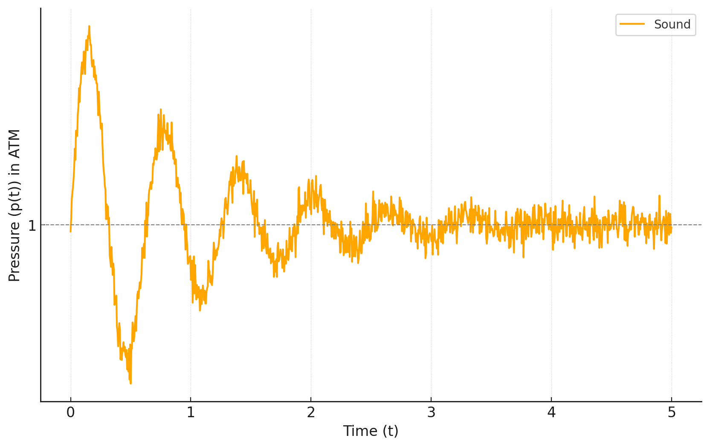
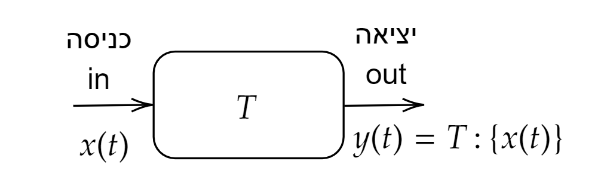
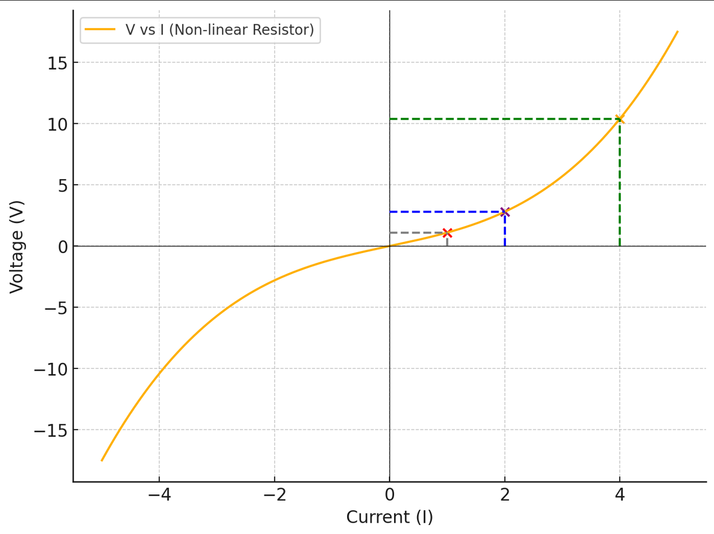
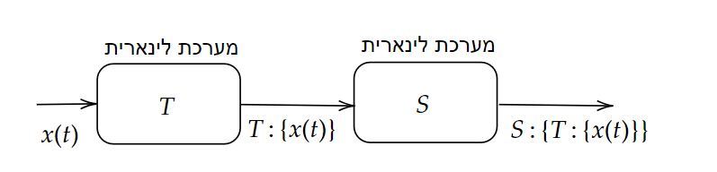
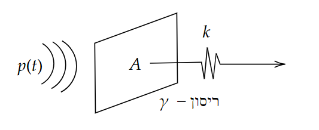
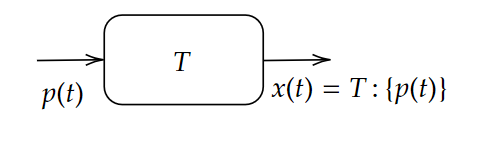

# מערכות לינאריות

<details>
<summary>אמ;לק</summary>

מערכת תהיה מוגדרת כמשהו שמקבל אות $x(t)$ ומחזיר אות $y(t)$

$$
T:\underset{input}{\left\{ \underbrace{x\left(t\right)}\right\} }=\underset{output}{\underbrace{y\left(t\right)}}
$$

מערכות לינאריות הן לינאריות (מי היה מאמין) ומקיימות:

$$T\{\alpha x_1 + \beta x_2\} = \alpha T\{x_1\} + \beta T\{x_2\}$$

שרשור של מערכות לינאריות הוא גם מערכת לינארית מה שעוזר מאוד בניתוח של מערכות

הרבה מהמערכות שאתם מכירים הן לינאריות בקירוב ולכן ניתוח של מערכות לינאריות הוא שימושי

</details>

## מוטיבציה

1. הרבה מערכות פיזיקליות הן לינאריות (לפחות בקירוב טוב)
2. התגובה לאות מורכב ע"י סכום תגובות לאותות פשוטים
3. מתמטיקה אלגנטית (אלגברה לינארית)
4. שרשור מערכות לינאריות הוא מערכת לינארית

## הגדרות

#### אות (סיגנל)

* פונקציה מתמטית המעבירה אינפורמציה אודות התנהגות של תופעה מסוימת

  דוגמאות:
    * $p(t)$ לחץ כפונקציה של זמן - כלומר אות אקוסטי
      
    * $V(t)$ מתח כפונקציה של זמן
    * $I(t)$ זרם כפונקציה של זמן
    * $T(t)$ טמפרטורה כפונקציה של זמן

הערת מסגרת קצרה: אות יכול להיות רציף או בדיד בזמן, סקלרי או וקטורי, דטרמיניסטי או אקראי, ולעיתים גם מרוכב (לא רק אמיתי). נשתמש בגרסאות השונות לפי ההקשר.

#### מערכת

* תהליך $T$ שיוצר טרנספורמציה מאות נתון לאות אחר

נסמן:

$$
T:\underset{input}{\left\{ \underbrace{x\left(t\right)}\right\} }=\underset{output}{\underbrace{y\left(t\right)}}
$$


למשל: מיקרופון הוא מערכת שממירה לחץ למתח/זרם חשמלי

$$
\underset{\text{ןופורקימה אצומב חתמ}}{\underbrace{V\left(t\right)}}=T:\left\{ p\left(t\right)\right\}
$$

#### מערכת לינארית

מערכת לינארית $T$ במרחב האותות היא מערכת המקבלת אות $x\left(t\right)$
בכניסה ומחזירה אות ביציאה $y\left(t\right)=T:\left\{ x\left(t\right)\right\} $
כאשר הטרנספורמציה $T$ מקיימת את עקרון הלינאריות (או סופרפוזיציה)
כלומר בהינתן אות מהצורה $x\left(t\right)=\alpha x_{1}\left(t\right)+\beta x_{2}\left(t\right)$ 
האות במוצא המערכת הלינארית יהיה הצירוף הלינארי של מוצא המערכת עבור כל 
אחד מהאותות בנפרד כלומר: 

$$
T:\underset{x\left(t\right)}{\underbrace{\left\{ \alpha x_{1}\left(t\right)+\beta x_{2}\left(t\right)\right\} }}=\alpha\underset{y_{1}\left(t\right)}{\underbrace{T:\left\{ x_{1}\left(t\right)\right\} }}+\beta\underset{y_{2}\left(t\right)}{\underbrace{T:\left\{ x_{2}\left(t\right)\right\} }}
$$

חשוב לציין שהתכונה הזו מאוד עוזרת לנו משום שאנחנו יכולים בתקווה לקחת אות
מורכב $x\left(t\right)$ ולכתוב אותו כחיבור של אותות פשוטים

במילים פשוטות: אם מכפילים ומחברים בכניסה — נקבל בדיוק את אותה הכפלה והחיבור ביציאה.

```{admonition} תכל׳ס – מה לקחת מפה?
:class: tip
מערכת לינארית מגיבה באופן פרופורציונלי ומצטבר. זה מאפשר לנו לבנות תגובות מורכבות מסכום תגובות פשוטות.
```

### דוגמא למערכת לא לינארית
ניקח את המערכת הכי פשוטה שאנחנו יכולים לחשוב עליה. מדידת מתח על נגד שזורם בו זרם
כמו שנלמד בקורס בחשמל, ניתן לתאר את הנגד באמצעות מספר אחד $R$
שמסמן את ההתנגדות שלו. תחת המודל המקורב הזה ניתן לרשום את חוק
אום:

$$
V=IR
$$

או כמו שמסמנים בקורס:

$$
V\left(t\right)=R:\left\{ I\left(t\right)\right\} =R\cdot I\left(t\right)
$$

כלומר הנגד הוא מערכת לינארית הממירה זרם למתח. 

אבל כמו כל מודל גם חוק אום נכון רק בקירוב. אם לוקחים נגד אמיתי ומודדים
אותו מגלים שבזרמים גדולים "ההתנגדות" משתנה.
אנחנו כל כך רגילים לחשוב על נגד בתור רכיב עם התנגדות שאנחנו מוכנים
לחשוב על מודל בו "ההתנגדות משתנה". כלומר השיפוע של הגרף $V\left(I\right)$ משתנה
הקשר בין הזרם למתח יכול להיראות לדוגמה ככה

 מכאן ניתן לראות שאם לדוגמא אנחנו מזרימים זרם $I_{1}\left(t\right)=1$ וזרם $I_{2}\left(t\right)=2$ המערכת כבר לא לינארית
כלומר שאם ניקח לדוגמה את הקומבינציה $I\left(t\right)=2I_{1}\left(t\right)+I_{2}\left(t\right)=4$ היינו מצפים
לקבל מתח:

$$
V\left(t\right)=R:\left\{ I\left(t\right)\right\} =R:\left\{ 2I_{1}\left(t\right)+I_{2}\left(t\right)\right\} =2R:\left\{ I_{1}\left(t\right)\right\} +R:\left\{ I_{2}\left(t\right)\right\} 
$$
אך אנחנו רואים מהגרף שהתגובה היא חזקה בהרבה יותר
למה זה בכל זאת שימושי לנו לדבר על מערכות לינאריות? כי הרבה מערכות הן בקירוב טוב לינאריות.
גם כאן, אם נפעל בטווחי זרם קטנים (אזור עבודה), אפשר לקרב את העקומה בקו ישר ולקבל התנהגות כמעט לינארית.

### שרשור מערכות לינאריות _(הוא מערכת לינארית)_

לפני ההוכחה, למה זה חשוב? כי לעיתים מחברים רכיבים זה לזה, ורוצים לדעת אם נשארים "בעולם הלינארי".
נניח שיש לנו שתי מערכות $T$ ו$S$. האם גם המערכת הכוללת היא לינארית?
קל לחשב:

$$
ST:\left\{ x\left(t\right)\right\} =S:\left\{ T:\left\{ \alpha x_{1}\left(t\right)+\beta x_{2}\left(t\right)\right\} \right\} \underset{\text{תיראניל\ }T}{\underbrace{=}}S:\left\{ \alpha T:\left\{ x_{1}\left(t\right)\right\} +\beta T:\left\{ x_{2}\left(t\right)\right\} \right\} 
$$
$$
\underset{\text{תיראניל\ }S}{\underbrace{=}}\alpha S:\left\{ T:\left\{ x_{1}\left(t\right)\right\} \right\} +\beta S:\left\{ T:\left\{ x_{2}\left(t\right)\right\} \right\} =\alpha ST:\left\{ x_{1}\left(t\right)\right\} +\beta ST:\left\{ x_{2}\left(t\right)\right\}  
$$
$ \blacksquare$

### דוגמה: ממברנה של מיקרופון
בפועל כדי באמת להבין מה קורה צריך לפתור את משוואת הגלים על הממברנה
ביחד עם תנאי שפה ואילוץ של האוויר. אבל אנחנו ניקח מודל פשטני

כלומר יש גל לחץ שפוגע בממברנה והיא מתחילה להתנדנד
לממברנה יש "קשיחות" או "מתיחות" שאותה נסמן ב$k$
את שטח הממברנה נסמן ב$A$ ואת קבוע הדעיכה של התנודות ב$\gamma$
נוסיף פירוש פיזיקלי קצר: $m$ היא המסה (אינרציה), $\gamma$ מייצג ריסון/חיכוך (דאיכה), ו-$k$ מייצג קשיחות/קפיץ (החזרה למצב שיווי-משקל).
כעת נוכל לרשום את החוק השני של ניוטון:

$$
F\left(t\right)=ma=m\ddot{x}
$$
$$
F\left(t\right)=Ap\left(t\right)-\gamma\dot{x}-kx
$$

כלומר קיבלנו מערכת

אשר הקלט שלה הוא $p\left(t\right)$ והפלט שלה הוא $x\left(t\right)$
כדי למצוא את $x\left(t\right)$ צריך לפתור משוואה דיפרנציאלית. אבל כדי להראות שהיא לינארית אנחנו לא צריכים לדעת לפתור משוואות דיפרנציאליות
אלא רק להראות שהיא מקיימת את תכונת הלינאריות. נניח שיש לנו שני קלטים $p_{1}\left(t\right)$ ו$p_{2}\left(t\right)$
עבור $p_{1}\left(t\right)$ המערכת מוציאה $x_{1}\left(t\right)$ שמקיים

$$
Ap_{1}\left(t\right)=m\ddot{x}_{1}+\gamma\dot{x}_{1}+kx_{1}
$$

עבור $p_{2}\left(t\right)$ המערכת מוציאה $x_{2}\left(t\right)$ שמקיים

$$
Ap_{2}\left(t\right)=m\ddot{x}_{2}+\gamma\dot{x}_{2}+kx_{2}
$$

נניח שתנאי ההתחלה שלנו זה שהממברנה במנוחה כלומר

$$
x\left(0\right)=\dot{x}\left(0\right)=0
$$

זה פתרון שנקרא ZSR (Zero State Response) כלומר שאין אנרגיה אגורה במערכת בזמן ההתחלה
כעת נציב:

$$
p\left(t\right)=\alpha p_{1}\left(t\right)+\beta p_{2}\left(t\right)
$$

ונקבל:

$$
Ap\left(t\right)=A\left[\alpha p_{1}\left(t\right)+\beta p_{2}\left(t\right)\right]=\alpha Ap_{1}\left(t\right)+\beta Ap_{2}\left(t\right)
$$
$$
=\alpha\left(m\ddot{x}_{1}+\gamma\dot{x}_{1}+kx_{1}\right)+\beta\left(m\ddot{x}_{2}+\gamma\dot{x}_{2}+kx_{2}\right)
$$
$$
=m\left(\alpha\ddot{x}_{1}+\beta\ddot{x}_{2}\right)+\gamma\left(\alpha\dot{x}_{1}+\beta\dot{x}_{2}\right)+k\left(\alpha x_{1}+\beta x_{2}\right)
$$
$$
=m\frac{d^{2}}{dt^{2}}\left(\alpha x_{1}+\beta x_{2}\right)+\gamma\frac{d}{dt}\left(\alpha x_{1}+\beta x_{2}\right)+k\left(\alpha x_{1}+\beta x_{2}\right)
$$

כלומר שאם נגדיר אות מהצורה $\alpha x_{1}+\beta x_{2}$ נגלה שהוא מקיים את המשוואה הדיפרנציאלית עבור קלט של $p\left(t\right)$
זה אומר בשפה שלנו ש:

$$
T:\underset{p\left(t\right)}{\underbrace{\left\{ \alpha p_{1}\left(t\right)+\beta p_{2}\left(t\right)\right\} }}=\alpha x_{1}+\beta x_{2}=\alpha\underset{x_{1}\left(t\right)}{\underbrace{T:\left\{ p_{1}\left(t\right)\right\} }}+\beta\underset{x_{2}\left(t\right)}{\underbrace{T:\left\{ p_{2}\left(t\right)\right\} }}
$$

כלומר המערכת לינארית!

```{admonition} תמצית
:class: tip

חיבור של מערכות לינאריות נשאר לינארי, והמיקרופון בדגם זה מתואר ע"י משוואה לינארית – לכן ניתן לפרק קלטים מורכבים לסכום רכיבים פשוטים להפעיל את המערכת על כל אחד בנפרד ולהרכיב את הפלט.

```

### דוגמאות נוספות
1. מעגלי RLC (נלמד בהמשך הקורס)
2. התפשטות גלים (גם אקוסטיים וגם אלקטרומגנטיים) — לפחות נכון בקירוב
3. אנטנות
4. פילטרים, מגברים
5. בולמי זעזועים
