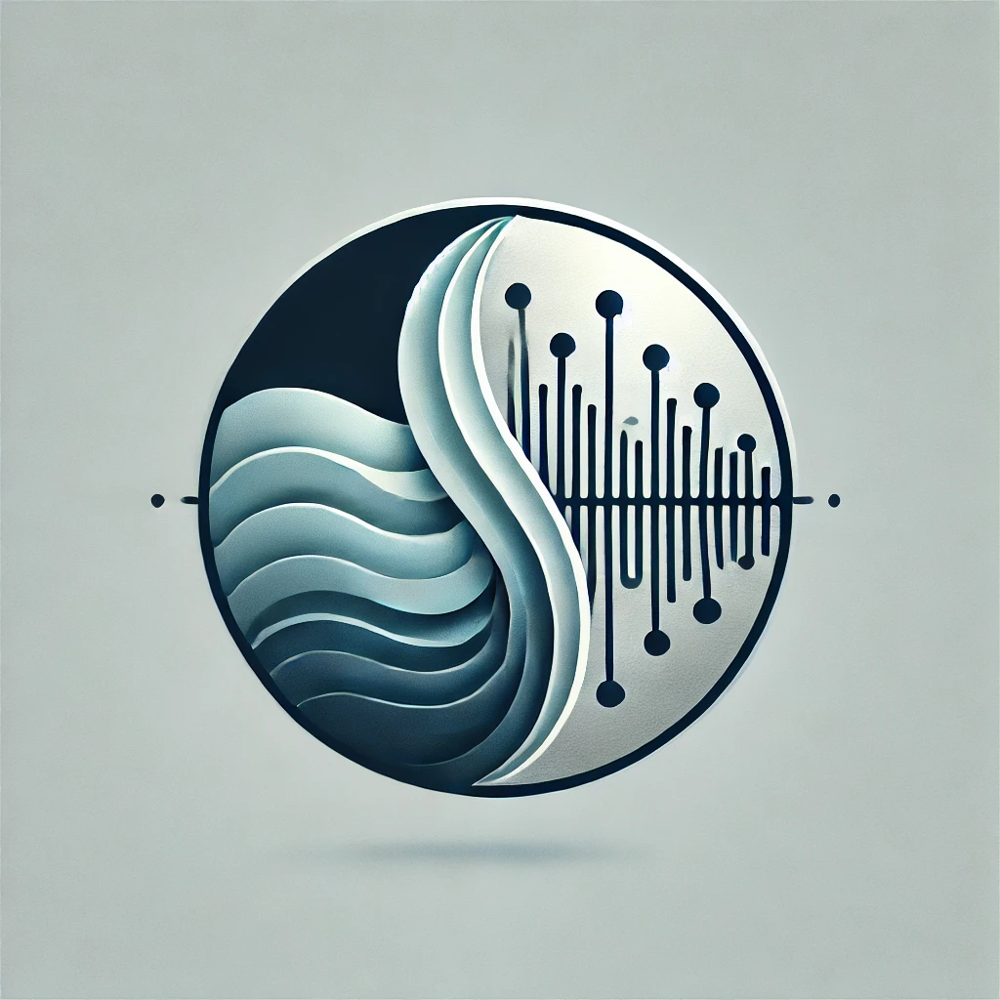

# מאלגברה לינארית לאייפון

<details>
<summary>אמ;לק</summary>

הקורס מחבר בין אלגברה לינארית, פורייה והסתברות לבין מערכות ואותות בעולם האמיתי: מסננים, מעגלים, שידור, דגימה ורעש.

הרעיון שחוזר לאורך הקורס הוא לפרק אות לרכיבים פשוטים, להבין מה המערכת עושה לכל רכיב, ואז לחבר בחזרה. בהמשך נוסיף את המגבלות של רוחב פס, הספק ושגיאות.

</details>



ברוכים הבאים לקורס. המטרה שלנו היא לקחת רעיונות מאלגברה לינארית, מערכות לינאריות, פורייה והסתברות, ולראות איך הם הופכים לכלים הנדסיים אמיתיים: מיקרופון, פילטר, משדר רדיו, דגימה, רעש, גילוי אותות, דחיסה וקיבול ערוץ.

השם "מאלגברה לינארית לאייפון" הוא תזכורת לכך שהדרך בין וקטורים, מטריצות ופונקציות לבין טלפון בכיס אינה קסם. היא בנויה משכבות של מודלים פשוטים, וכל שכבה נותנת לנו שפה טובה יותר לתאר את העולם.

## איך להשתמש באתר

כל פרק בנוי כך שאפשר לקרוא אותו בשלוש דרכים:

1. קריאה מהירה: התחילו ב-`אמ;לק`, האיורים, הדוגמאות והסיכומים.
2. קריאה מלאה: עברו גם על הפיתוחים המתמטיים, ההוכחות וההערות המתקדמות.
3. הכנה לשיעור או חזרה למבחן: חזרו לטבלאות, לתיבות הסיכום, ולשאלות המחשבה בסוף חלק מהפרקים.

```{admonition} המלצה ללמידה
:class: tip
בכל פעם שמופיעה נוסחה כבדה, נסו קודם לומר במילים מה היא עושה. למשל: "פילטר מכפיל כל תדר במספר אחר", או "דגימה משכפלת את הספקטרום". אם המשפט המילולי ברור, המתמטיקה נהיית הרבה פחות מאיימת.
```

## מפת הקורס

- **מערכות לינאריות**: נלמד מהו אות, מהי מערכת, למה לינאריות היא קירוב כל כך שימושי, ואיך תגובה להלם ותגובה בתדר מתארות מערכת שלמה.

- **מעגלי RC/RLC**: נחבר את שפת המערכות לרכיבים חשמליים, פילטרים, תהודה, Q-factor, הספק ותיאום עכבות.

- **תקשורת אנלוגית**: נראה למה בכלל צריך גל נושא, איך AM/FM/PM עובדים, ואיך משדרים ומקלטים מממשים את הרעיונות האלה.

- **תקשורת דיגיטלית**: נעבור מביטים לסימבולים, מקונסטלציות ל-I/Q, וממודולציות פשוטות לבעיות אמיתיות כמו סנכרון פאזה ו-ISI.

- **דיגיטציה ושחזור**: נלמד דגימה, aliasing, משפט נייקוויסט-שאנון, אינטרפולציה וקוונטיזציה.

- **רעש וגילוי**: נבנה את השפה של אותות אקראיים, PSD, רעשים פיזיקליים, סינון רעש, ROC ו-match filter.

- **DSP ותורת האינפורמציה**: נסיים עם DFT ככלי חישובי מרכזי, ועם שאנון: אנטרופיה, רצפים טיפוסיים וקיבול ערוץ.

## מה כדאי לדעת מראש

- אלגברה לינארית בסיסית: וקטורים, בסיסים, מכפלה פנימית, ערכים עצמיים.
- חדו"א: נגזרות, אינטגרלים, משוואות דיפרנציאליות פשוטות.
- מספרים מרוכבים: מופע, גודל, $e^{i\omega t}$.
- הסתברות בסיסית: תוחלת, שונות, התפלגות.

לא חייבים לזכור הכל מראש. חלק גדול מהקורס נועד גם לבנות אינטואיציה מחדש, הפעם דרך מערכות ואותות.

## סימונים שחוזרים הרבה

| סימון | משמעות |
| --- | --- |
| $x(t)$ | אות בזמן רציף |
| $x[n]$ | אות בזמן בדיד |
| $\tilde{X}(\omega)$ | ייצוג בתדר |
| $h(t)$ | תגובה להלם |
| $H(\omega)$ | תגובה בתדר / פונקציית תמסורת |
| $\ast$ | קונבולוציה |
| $S_{xx}(\omega)$ | צפיפות הספק ספקטרלית (PSD) |

## איך לחשוב על הקורס

הקורס אינו אוסף נוסחאות. הוא סיפור אחד:

1. מפרקים אותות לרכיבים פשוטים.
2. מבינים איך מערכת משנה כל רכיב.
3. מחברים בחזרה.
4. מוסיפים מגבלות של העולם האמיתי: רעש, רוחב סרט, דגימה, עוצמה ושגיאות.

אם תחזיקו את ארבעת השלבים האלה בראש, הרבה פרקים שנראים שונים מאוד יתחילו להרגיש כמו וריאציות על אותו רעיון.
